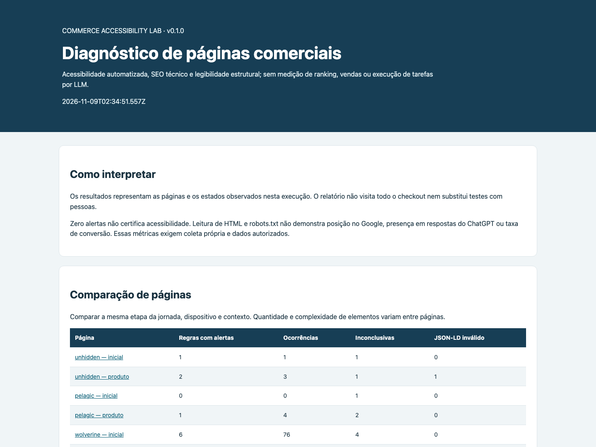
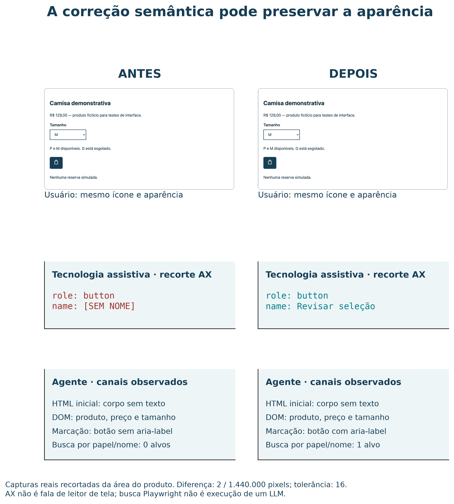

# Commerce Accessibility Lab

Ferramenta de pesquisa para avaliar **acessibilidade automatizada, SEO técnico e legibilidade para agentes** em páginas de comércio eletrônico. Compara uma página com um concorrente, sugere melhorias com evidências e recompõe os resultados preservados do estudo inicial.

O relatório é um HTML em português, com gráficos, comparação, recomendações e links para as evidências. Também são exportados JSON e CSV. Não exige chave de IA ou acesso ao analytics para a auditoria técnica.



Um [exemplo completo, recomposto dos registros do estudo](examples/study-report.html), acompanha o código; baixe e abra o HTML para visualizar.

## Começar

Requisitos: Node.js 22 ou superior e um ambiente que possa executar Chromium.

```bash
git clone https://github.com/JonatasRicardo/commerce-accessibility-lab.git
cd commerce-accessibility-lab
npm ci
npx playwright install chromium
```

No Linux, se faltarem dependências do navegador, use `npx playwright install --with-deps chromium`.

### Avaliar uma página e um concorrente

```bash
node bin/commerce-audit.mjs audit \
  'https://unhidden.com/products/backless-crop-top' \
  --competitor 'https://pelagicgear.com/en-br/collections/fishing-shirts/products/exo-tech-solid-mangrove/' \
  --out reports/comparacao
```

Abra `reports/comparacao/report.html`. Os exemplos são duas páginas de produto; categoria, público e complexidade continuam diferentes. Para uma comparação de negócio, escolha páginas equivalentes da jornada e registre as diferenças de contexto.

### Reproduzir os números preservados do artigo

```bash
npm run study -- --out reports/reproducao
```

O modo padrão é **replay**: verifica hashes dos arquivos e recalcula as contagens a partir dos registros de 8 de novembro de 2026. Não abre as lojas e não repete o motor de acessibilidade. As seis linhas devem ser:

| Página | Regras com alertas | Ocorrências regra-elemento | Regras inconclusivas |
| --- | ---: | ---: | ---: |
| Unhidden — inicial | 1 | 1 | 1 |
| Unhidden — produto | 2 | 3 | 1 |
| PELAGIC — inicial | 0 | 0 | 1 |
| PELAGIC — produto | 1 | 4 | 2 |
| Wolverine — inicial | 6 | 75 | 4 |
| Wolverine — produto | 4 | 39 | 6 |

### Repetir a coleta atual nas mesmas seis páginas

```bash
node bin/commerce-audit.mjs study --mode live --out reports/nova-coleta
```

Esse comando visita as URLs do conjunto preservado e compara a nova coleta com a referência. Conteúdo, estoque, scripts, localização, banners e navegador podem mudar. O relatório registra igualdade de HTML, navegador, axe e configuração; não promete os mesmos resultados de uma data anterior.

### Executar os testes locais de correção

```bash
npm run microtests -- --out reports/correcoes
```

Reproduz uma estrutura mínima de três botões: falhas de nomeação **3 → 0**, alvo localizado pelo nome **0 → 1** e clique confirmado. Também reproduz o mecanismo de JSON-LD com quebra de linha não escapada e preserva o texto após correção. O segundo caso usa conteúdo demonstrativo, e não o payload integral da loja. Os testes não medem vendas nem desempenho de um modelo de linguagem.

### Consultar código antigo no Wayback Machine

```bash
node bin/commerce-audit.mjs archive 'https://pelagicgear.com/' \
  --at 20230101 --out reports/historico
```

Para comparar indicadores estáticos com uma auditoria atual da mesma URL, acrescente `--current reports/auditoria/report.json`. São registrados a data solicitada, a captura efetiva e redirecionamentos. Uma captura pode corresponder a domínio estacionado, erro ou outro conteúdo: confirme a identidade antes de interpretar as contagens. Não são executados scripts no HTML histórico.

### Comparar duas auditorias salvas

```bash
node bin/commerce-audit.mjs compare \
  reports/antes/report.json reports/depois/report.json \
  --out reports/antes-depois
```

Esse modo combina relatórios e compara as mesmas URLs/identidades; diferenças entre domínios diferentes são apresentadas na tabela geral, sem inventar correspondências.

## O que é avaliado

- **Acessibilidade:** regras A/AA dos grupos configurados do axe, elementos afetados e itens inconclusivos; nomes computados de controles e amostra de navegação por Tab.
- **SEO técnico:** resposta HTTP, título, descrição, idioma, títulos principais, canonical e instruções de indexação observadas.
- **Informações de produto:** sintaxe JSON-LD, objetos `Product`/`ProductGroup`, nome, SKU, preço, moeda e disponibilidade quando presentes nesse canal.
- **Agentes:** regras de `Googlebot`, `OAI-SearchBot`, `GPTBot` e `ChatGPT-User` no robots.txt; diferença entre dados no HTML recebido e após scripts. São indicadores estruturais, não um benchmark de LLM.
- **Melhorias:** ações priorizadas, evidência correspondente e distinção entre observação, alerta automático e revisão contextual.

Não há uma nota combinada de “acessibilidade + SEO + IA”: esses desfechos não são equivalentes. Zero alertas não certifica conformidade WCAG. Falha ou bloqueio de coleta aparece como **não medido**, em vez de zero falhas. Permissão no robots.txt não comprova acesso do robô, indexação ou recomendação.

## Taxas de conversão e dados comerciais

HTML não revela a taxa de conversão de uma loja. Você pode acrescentar dados autorizados com `--analytics arquivo.json`. Use unidades que converteram, não o número de pedidos, para evitar confundir múltiplos pedidos do mesmo visitante.

```json
[
  {
    "url": "https://example.org/produto",
    "periodStart": "2026-10-01",
    "periodEnd": "2026-10-31",
    "source": "Exportação autorizada do analytics",
    "unit": "visitors",
    "denominator": 1000,
    "convertingUnits": 20
  }
]
```

O resultado seria 2%, como cálculo desses dados fornecidos. Comparabilidade de período, população e atribuição exige análise própria; o instrumento não atribui esse resultado causalmente à acessibilidade. Também não mede posições reais no Google, frequência de recomendação no ChatGPT, Core Web Vitals de campo ou conformidade integral do checkout.

## Configuração e arquivos

As versões estão fixadas no lockfile: **axe-core 4.10.3** e **Playwright 1.62.1**, preservando a família de navegador usada no estudo. Cada coleta registra as versões realmente executadas.

```bash
node bin/commerce-audit.mjs audit 'https://example.org/produto' \
  --width 1440 --height 1000 --wait-ms 3500 \
  --locale en-US --save-html --out reports/minha-avaliacao
```

`--save-html` é opcional. Saídas ficam em `reports/`, ignorada pelo Git, e uma pasta que já contém relatório não é sobrescrita. Os relatórios não incluem cookies ou credenciais de autenticação. Antes de publicar uma nova coleta, revise os arquivos que pretende compartilhar.

## Skill opcional

A pasta [`skill/commerce-accessibility-audit`](skill/commerce-accessibility-audit/SKILL.md) contém instruções para usar a ferramenta em linguagem natural no Codex.

No macOS/Linux, a partir da raiz do clone:

```bash
mkdir -p ~/.codex/skills
ln -s "$PWD/skill/commerce-accessibility-audit" ~/.codex/skills/commerce-accessibility-audit
```

Se esse caminho já existir, preserve a instalação existente. Em outra forma de instalação, configure `COMMERCE_AUDIT_ROOT` para apontar ao clone. A skill passa a estar disponível após a atualização da descoberta de skills do aplicativo.

Exemplo de pedido: “Use `$commerce-accessibility-audit` para avaliar esta página e compará-la com este concorrente; mostre as melhorias e as evidências.”

## Validação

```bash
npm test
npm run test:browser
npm run study -- --out reports/verificacao
```

Testes unitários cobrem extração, regras de rastreamento, integridade, comparação, dados comerciais, erro de coleta e escape do relatório. Os testes de navegador usam uma loja demonstrativa local e verificam o percurso completo até o relatório. A CI não depende da disponibilidade dos sites externos.

## Método e citação

- [Método, fontes e limites](docs/METHOD.md).
- [Origem do conjunto preservado](study/README.md).
- [Citação do software](CITATION.cff).

O código novo é distribuído sob MIT. Registros de observações públicas não alteram direitos sobre nomes, marcas, textos ou código dos sites examinados. Não há código, banco de dados ou documentos corporativos do projeto HEOR neste repositório. A preparação inicial deste instrumento contou com assistência de IA e deve ser revisada pelos responsáveis antes de uso confirmatório em pesquisa.

## React, CI e antes/depois visual — v0.2



```bash
npm run react:verify -- --out reports/react-demo
node bin/commerce-audit.mjs practices --repo . --out reports/praticas
node bin/commerce-audit.mjs gate reports/react-demo/states-accessible.json \
  --policy policies/accessibility-gate.json --out reports/gate
```

O [exemplo visual completo](examples/react-practices-report.html) apresenta **Antes / Depois** em três canais: captura do viewport, papéis e nomes na árvore de acessibilidade do Chromium, e texto/controles/JSON-LD disponíveis no DOM. O controle negativo e a versão corrigida mantêm a mesma biblioteca Radix e o mesmo ícone: a aparência se mantém, mas o botão passa de sem nome para “Revisar seleção”. O localizador por papel e nome passa de zero para um alvo. Não é um teste de LLM ou gravação de leitor de tela.

Auditorias novas preservam essas visões em `report.json`. Para acompanhar uma correção sua, execute `audit` antes e depois e use o comando `compare` já apresentado; ou acrescente `--baseline reports/antes/report.json` à nova auditoria. Cada versão mostra a data e o viewport. Capturas antigas não disponíveis não são inventadas. Relatórios podem conter o texto visível de uma página: revise-os antes de publicar.

O modo `practices` gera uma matriz de sete práticas com evidências por arquivo: biblioteca integrada, lint JSX, testes de teclado/foco, gate no CI, versões/artefatos, skills/agentes e critérios de aceitação. A inspeção é estática e limitada ao recorte documentado. Para acrescentar evidência pública de execução, use `--ci-run URL_DO_RUN`; só o mesmo commit sem alterações locais é identificado como correspondente.

`audit URL --profile react` relaciona os achados da página às práticas preventivas. Não identifica automaticamente as bibliotecas ou o processo de um concorrente. O [protocolo ágil e as referências](docs/AGILE-ACCESSIBILITY.md) explicam a averiguação e seus limites. Agentes e skills têm critérios e registros de contribuição; sua presença não prova produtividade ou revisão independente.

A [CI](.github/workflows/verify.yml) executa lint, tipos, testes de navegador, experimento React, gate explícito e replay do estudo. Reprova o controle negativo dentro do experimento e exige aprovação dos estados válidos. Os artefatos têm retenção de 30 dias; o conjunto selecionado em `study/react-practices-v0.2` permanece versionado. Um job reprovado exige proteção de branch configurada separadamente para impedir merge.

A comparação visual do exemplo mede os pixels decodificados: a coleta preservada registrou 2 pixels diferentes em 1.440.000, com limite explícito de 16 para variação de rasterização. Contagem, percentual e hashes são expostos no relatório; o gate de acessibilidade é independente dessa tolerância.
